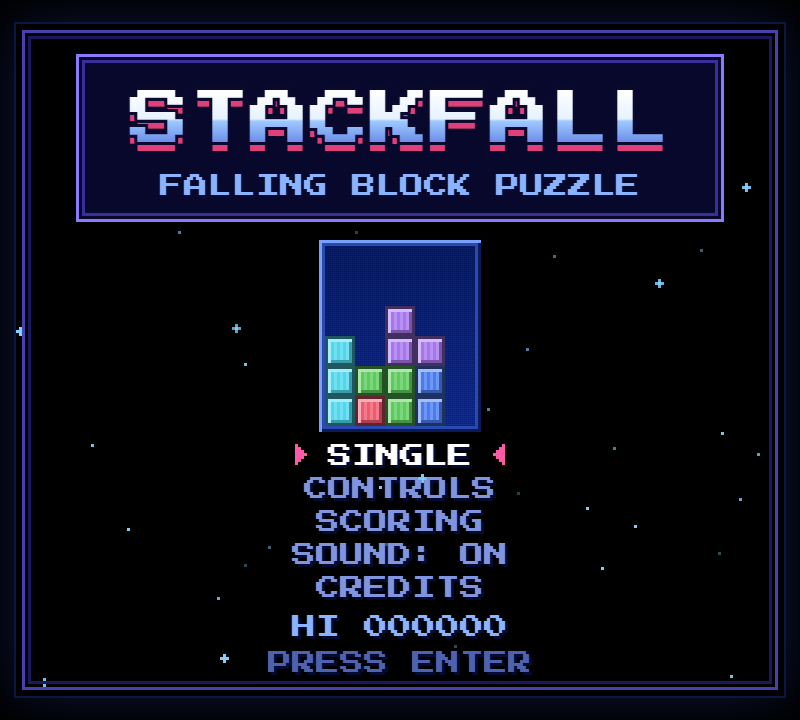
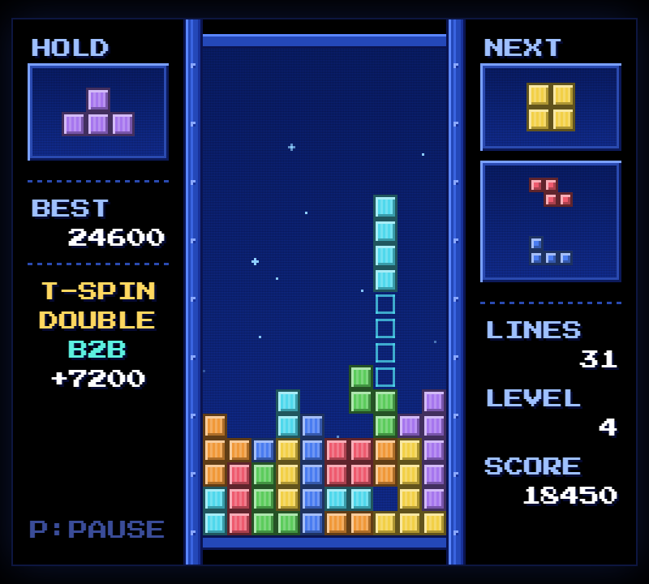

# Stackfall

A retro pixel-art falling block puzzle game that runs in the browser, on desktop and on phones.
It started as a Python/pygame project and now has a full web version with a handheld-console look,
modern rules, touch controls and chiptune sound.

**▶ Play it: [stackfall-snowy.vercel.app](https://stackfall-snowy.vercel.app)**
(also on [GitHub Pages](https://1anc6.github.io/Tetris-Game-Simulation-using-Python/))

<p align="center">
  
  
</p>

## Features

- **Retro look**: pixel font, starfield background, LED-style playfield and chunky striped blocks
- **Modern rules**: hold piece, 3-piece next queue, ghost piece, 7-bag randomizer, SRS rotation with wall kicks, lock delay
- **Levels**: every 10 lines raises the level and the falling speed
- **Guideline scoring**: T-spins, back-to-back bonus, combos and perfect clears (see [Scoring](#scoring))
- **Plays on phones**: on-screen buttons plus swipe gestures, in portrait and landscape
- **Sound**: synthesized chiptune sound effects and an original music loop, no audio files
- **Menus**: title screen, controls, scoring and credits screens, pause menu and game over screen
- **Saves your best score** in the browser

## Controls

### Keyboard

| Key | Action |
|---|---|
| ← → (or A / D) | Move |
| ↓ (or S) | Soft drop |
| Space | Hard drop |
| ↑ / X (or W) | Rotate clockwise |
| Z / Ctrl | Rotate counter-clockwise |
| C / Shift | Hold |
| P / Esc | Pause |
| M | Sound: on → effects only → off |
| Enter | Select in menus |

### Touch

The buttons appear automatically on phones and tablets: move and soft drop on the left,
rotate / drop / hold / pause on the right. You can also play right on the board:

| Gesture | Action |
|---|---|
| Tap | Rotate |
| Drag left / right | Move |
| Drag down | Soft drop |
| Flick down | Hard drop |
| Flick up | Hold |

## Scoring

You only score when rows are cleared. Dropping pieces gives no points.
Every value below is multiplied by your current level.

| Clear | Points |
|---|---|
| Single / Double / Triple / Quad (4 rows) | 100 / 300 / 500 / 800 |
| T-spin Single / Double / Triple | 800 / 1200 / 1600 |
| Mini T-spin Single / Double | 200 / 400 |
| Back-to-back (quads or T-spins in a row) | ×1.5 |
| Combo (clearing with consecutive pieces) | +50 × combo count |
| Perfect clear (board left empty) | +800 to +3200 |

A T-spin counts when the T piece's last move was a rotation and 3 of the 4 corners around its center are blocked.

## Run it locally

The web game is a single file with no build step. Open `index.html` in a browser, or serve the folder:

```bash
npx serve .
```

### Python version

The original pygame version is in [`Final Tetris Project`](Final%20Tetris%20Project). It's the simpler starting
point the web game grew from (classic layout, basic scoring, no hold or levels).

```bash
pip install pygame
cd "Final Tetris Project"
python main.py
```

Controls: arrow keys to move, ↓ to soft drop, ↑ to rotate, any key to restart after game over.

## Project structure

```
index.html              The whole web game: HTML, CSS and JavaScript in one file
docs/                   Screenshots used in this README
Final Tetris Project/   Original Python / pygame version
.github/workflows/      GitHub Pages deployment
```

Inside `index.html` the script is split into sections: config and piece data, canvas scaling, sprites,
sound engine, game state and rules, input (keyboard, buttons, gestures) and rendering.
To rename the game, change `GAME_TITLE` at the top of the script.

## Deployment

Every push to `main` deploys automatically to:

- **Vercel**: [stackfall-snowy.vercel.app](https://stackfall-snowy.vercel.app)
- **GitHub Pages**: via `.github/workflows/static.yml`

## Credits

- Pixel font: [Press Start 2P](https://fonts.google.com/specimen/Press+Start+2P) by CodeMan38 (SIL Open Font License)
- Game, graphics, sound effects and music made for this project
